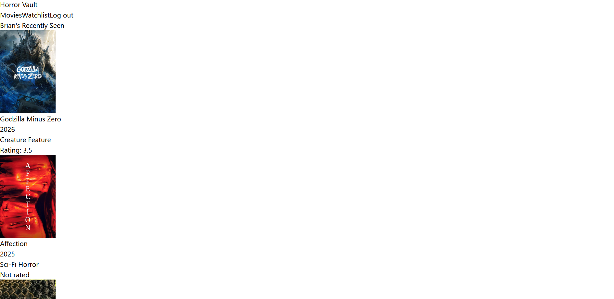
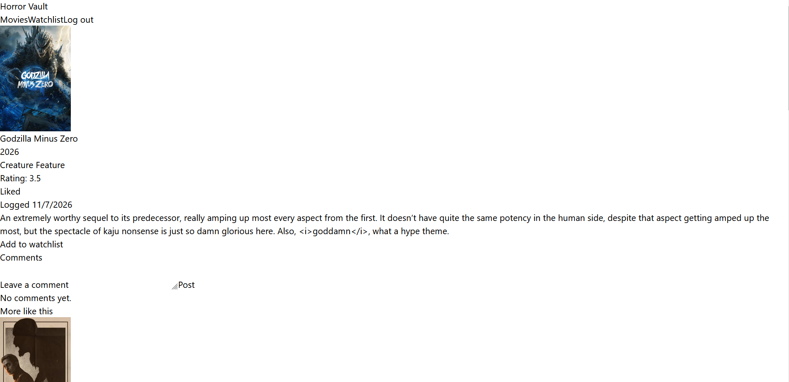
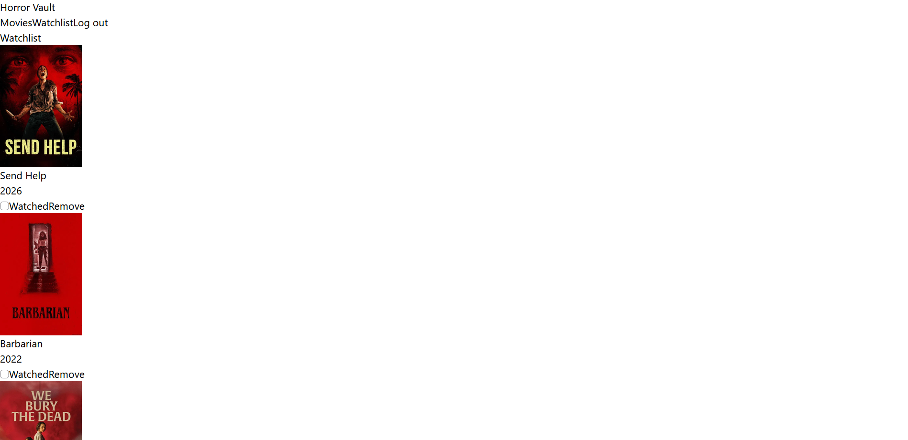

# Horror-Vault-Frontend

A horror movie database built from my Letterboxd ratings to which help recommend and find new movies to watch

## Overview

Horror Vault is a horror movie database built from my own Letterboxd ratings and reviews. Every movie is tagged by a subgenre like "slasher", "folk horror", "found footage"... so you can browse by the kind of horror you're in the mood for based off my own appraisals of said movies and/or then find similar movies based off the tags and my ratings!

It has a sign-up/login feature so people can browse the selection and save movies to their watchlist and mark what they've watched. Every movie page suggests more picks from the same subgenre, ranked by my ratings. It's like a smaller Letterboxd, but (for now) just built around horror and sorted and presented off "Brian's"(my own) estimations of the films as an interactive movie blog of sorts.

## Screenshots

## Core features

- A Homepage with recent entries and random suggested highly regarded movies
  User story:
  As a visitor I'd like to see what 'Brian' has been seeing and some random suggestions based off what he's rated highly already so that I can find something unexpected to watch

- An accounts section where users can register, log in and log out.
  User story:
  As a visitor and new enthusiast of 'Brian', I'd like to login/create an account so that I can keep track of specific movies I've seen of Brian's viewed that appeal to me

- Browse function to go through the selection of movies through name, year, subgenre tag based off data pulled from my letterboxd to fill out which movies appear and certain details
  - Search function to find movies by title or the used tags
  - Detailed page for each movie with brief info on the movie and my rating and review (if available).
    User story:
    As a visitor I'd like to see all of Brian's selection and to be able to search for certain titles or subgenres so that I can better cater to my own tastes by finding the stuff I'm more interested in and/or see what Brian's appraised of movies I've already seen

- Watchlist feature for logged-in users to add or remove movies from their list and/or mark as watched
  User story:
  As a visitor I'd like to add things to my watchlist so that I have them all placed here in a single list for me to see and check off instead of finding in the larger movie list

- A "more like this" for each movie page that'll suggest my highest-rated or "liked" (good-bad movies) movies from the same subgenre.
  User story:
  As a visitor I'd like to see other movies within the same subgenre so clicking a "more like this" expands a selection to see all titles of the subgenre

- A comments section under each movie where logged-in users can post their own comments and delete them
  User story:
  As a visitor I'd like to validate Brian's judgement for movies by contributing to a comments section so that I can share my own feelings towards Brian's opinions and maybe help show any biases he might have to help future visitors' experience

## Stretch goals

- A Suggested For You function with suggestions based on the subgenre a user has watched or liked most.

- Sort feature to go by rating or year, maybe also a filter for short films or "liked films"

- A letterboxd link to the movie for more expansive details on the movie

- Maybe also a directors table to also sort by or search by

- User ratings as a percentage based off "thumbs up/thumbs down" to display alongside each title

- A second subgenre tag for movies that fit more than one

## Tech stack

- Frontend: React, React Router, Vite and Tailwind CSS
- Tools: GitHub Projects

## Architecture

The backend is an Express API connected to the PostgreSQL database, and the React frontend calls it with fetch. The backend is in the Horror-Vault-Backend repo.

Horror-Vault-Frontend
src
api - fetch calls to the backend
auth - login and register
home, movies, watchlist - the pages
layout - navbar

## Usage

1. Get the backend running first from the Horror-Vault-Backend repo.
2. Copy example.env to .env.
3. Run npm install
4. Then run npm run dev.

## Credits

Movie ratings and reviews are my own from Letterboxd. Movie posters come from TMDB. This product uses the TMDB API but is not endorsed or certified by TMDB.
